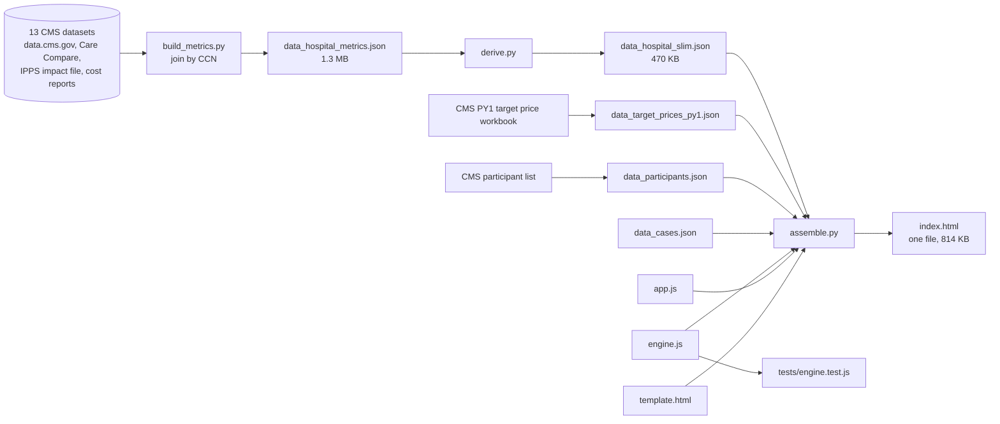
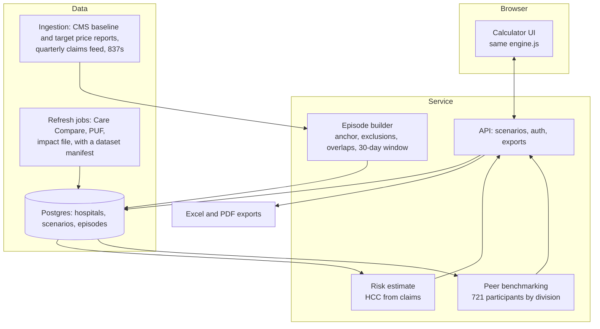

# TEAM Calculator architecture

One HTML file, built from a handful of source files and public CMS data. This note is the map: what the file is made of, how a number gets computed, where the design stops, and what version two looks like. The [decision record](decisions.md) explains why each choice was made.

## The pieces

| File | Role |
|---|---|
| `build/template.html` | Markup and CSS. Holds the placeholders the assembler fills: `__TP__` (target prices), `__PARTS__` (participants), `__CASES__`, `__HM__` (per-hospital metrics), `__ENGINE__`, `__APP__`. |
| `build/engine.js` | The reconciliation engine. Pure: no DOM, no page state. Reference tables (categories, MS-DRGs, tracks, lever defaults), track eligibility, the quality adjustment, lever savings, and `createEngine(TP)`, which binds the price table and returns `price`, `catCalc`, `reconcile(state, opts)` and `defaultState()`. The same file runs in the browser as `window.TEAMEngine` and in Node through `require`. |
| `build/app.js` | Everything the user touches. The state object, the hospital picker, the public-data prefill (`derivePublic`), the charts (inline SVG), the checks section, the scenario payload, the motion. It never computes a dollar itself; every figure comes from the engine. |
| `data/data_target_prices_py1.json` | 261 rows: 29 MS-DRGs by 9 census divisions, from the CMS PY1 preliminary target price workbook. |
| `data/data_participants.json` | The 721 hospitals on the CMS participant list, with CCN, CBSA and state. |
| `data/data_hospital_slim.json` | About 470 KB of per-hospital metrics derived from thirteen public datasets, embedded in the page so the prefill works offline. |
| `data/data_cases.json` | The six case hospitals: ids, CCNs, track and prose. Their numbers are derived from the slim file at load time, never stored. |
| `build/build_metrics.py` | Downloads the CMS sources and joins them by CCN into `data_hospital_metrics.json` (about 1.3 MB, not embedded). |
| `build/derive.py` | Compacts the metrics into the slim file the page ships. |
| `build/assemble.py` | Writes `index.html` from the template, the engine, the app and the JSON, plus a wrapper-free variant for the private preview. |
| `tests/engine.test.js` | Twenty-two engine tests. `node --test tests/` from the `team-calculator` folder, Node 18 or newer, no dependencies. |

## Data flow



## How a number is computed

For each of the five categories the engine does the same thing, in `catCalc`:

1. Regional price. The episode-weighted average of the PY1 target prices for the MS-DRGs the user entered, in the hospital's census division. The outpatient joint row prices at MS-DRG 470, as the CMS workbook note says.
2. Target. Regional price times the risk multiplier.
3. Spend. The user's number if typed, the derived public estimate if a hospital was picked, or the regional price. A spend shift option sets spend relative to the target for sensitivity lines.
4. Reconciliation. Target minus spend, times episodes. If the category is flagged low volume and the result is negative, it floors at zero.

Then `reconcile` sums the categories and applies the program rules in CMS order: the Track 1 floor at zero, the quality adjustment (10% of a positive amount withheld as CQS falls; up to 15% in Track 2 or 10% in Track 3 of a negative amount forgiven as CQS rises), the stop-gain and stop-loss as shares of the aggregated target, and 2% sequestration on a positive payment. Levers subtract per-episode savings from spend before reconciliation, scaled by the realization slider.

Nothing in that path reads the page. That is what makes the engine testable, and it is why the engine split changed no output: a snapshot of six case hospitals under seven option sets was identical before and after.

## Why one file

- Deployable anywhere, including as a private preview, with nothing to run and nothing to patch.
- Reviewable by view-source. A hiring manager or a CFO can see every rule.
- No tracking, no accounts, no patient data by construction.

The costs are known. The page is 814 KB because the hospital data rides inside it. The data is frozen at build time, so a refresh means rerunning two scripts and pushing. Nothing persists between visits. The engine was built pure from the start of this split so that none of those limits are baked into the math.

## Where the design stops

- Category averages times counts. TEAM reconciles at the episode, with anchor rules, exclusions, overlaps and outliers the public files cannot show.
- Spend, risk and quality for a named hospital are public proxies, labeled as such. The CMS baseline report a participant receives is the real input, and the page says so.
- Single hospital. Systems run TEAM across many CCNs and there is no roll-up.
- No export beyond print and a scenario payload. No saved scenarios, no audit trail.

## Version two

The engine does not change. Everything around it does.



In the order the developer review ranked them: ingest the hospital's own CMS files so spend and episodes are actual; store scenarios behind a login with Excel export; benchmark against the other participants from the dataset the page already carries; estimate risk from the hospital's claims; roll up a system. The first step that pays for itself is scenario storage with export, because that is the point where a finance team stops rebuilding the tool in a spreadsheet.

## Working on it

```bash
# from team-calculator/
python3 build/build_metrics.py   # re-download and join the CMS sources (slow, about 500 MB)
python3 build/derive.py          # compact to data_hospital_slim.json
python3 build/assemble.py        # write index.html
node --test tests/               # run the engine tests
```

Before changing the engine, snapshot `window.TEAMCALC.run()` for the six cases in the browser console, make the change, and compare. The page exposes `TEAMCALC` for exactly this.
